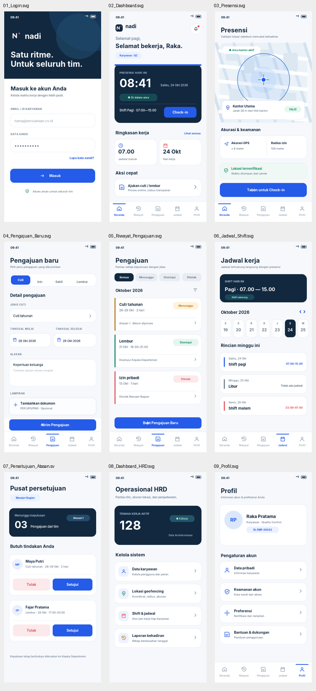
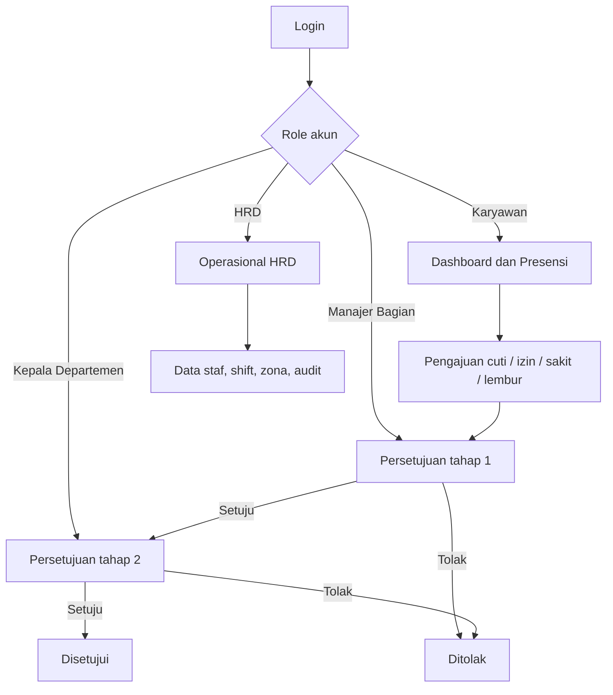

<div align="center">
  

  # NADI HRIS
  **Satu ritme. Untuk seluruh tim.**

  Flutter mobile • Workforce Time & Attendance • LBS / Geofencing • HR workflows

  [](https://github.com/imKul7/nadi-hris-flutter/actions/workflows/flutter-ci.yml)
  [](https://github.com/imKul7/nadi-hris-flutter/actions/workflows/api-ci.yml)
  
  

  <sub>Universitas Esa Unggul · Pemrograman Mobile · Kelompok 6 · 2026/2027</sub>
</div>

---

## Gambaran

**NADI HRIS** adalah implementasi proyek kelompok Workforce Time & Attendance. Desain antarmuka mengacu pada **sembilan layar orisinal Pertemuan 6** (frame 390×844, navy `#12283F`, royal blue `#245BE8`, red `#E34E54`, background `#F6F8FC`). Aplikasi dibuat memakai **widget Flutter**; desain SVG tidak digunakan sebagai pengganti UI.

> **Status terverifikasi — 26 November 2026:** GitHub Actions pada commit `dffe02e` (PR #4, merge ke `main`) lulus: **Flutter 3.47.0 — analyzer No issues found, 5/5 widget tests PASS; Node.js/SQLite — 10/10 API tests PASS**. Pengujian meliputi login, navigasi pengajuan, layout mobile, panel profil, endpoint foto, dan ganti password. **Build APK, pengujian visual seluruh layar pada perangkat, dan integrasi Flutter–API secara penuh belum dinyatakan PASS.** Source publik: [imKul7/nadi-hris-flutter](https://github.com/imKul7/nadi-hris-flutter).



## Mode aplikasi

| Mode | Cara kerja | Penggunaan |
|---|---|---|
| **Server API** | Login role asli dari API, SQLite lokal, CRUD pengajuan, review dua tahap, presensi GPS, shift, HRD | Pengujian fungsi end-to-end di jaringan lokal |
| **Pratinjau UI** | Sembilan layar referensi dengan state demo di memori | Presentasi frontend Pertemuan 8 tanpa perlu server |

### Sembilan layar yang dicakup

1. Login — form email/password; mode server dan pratinjau.
2. Dashboard Karyawan — identitas, status presensi, quick actions.
3. Presensi — lokasi kantor, GPS, radius, akurasi, check-in/out.
4. Pengajuan Baru — cuti, izin, sakit, lembur, periode, alasan.
5. Riwayat Pengajuan — daftar dan status.
6. Jadwal Kerja — shift yang ditetapkan HRD.
7. Pusat Persetujuan — manajer, kepala departemen, dan review HRD untuk permohonan kepala departemen.
8. Operasional HRD — staf, lokasi kantor, jadwal shift, audit aktivitas.
9. Profil — identitas akun, foto profil opsional, pengaturan tampilan, bantuan, serta ubah kata sandi pada mode Server API.

**Backend operasional lokal** (bukan simulasi frontend) memerlukan server Node 22.13+.

## Struktur proyek

```text
nadi_hris/
├── lib/
│   ├── main.dart               # Frontend sembilan desain + login dual mode
│   └── live/
│       ├── api.dart            # REST client (HTTP, token, error handling)
│       └── live_app.dart       # UI live connected semua role dan alur
├── assets/designs/           # 9 SVG acuan UI Pertemuan 6
├── server/
│   ├── src/database.mjs       # SQLite schema, scrypt password, seed
│   ├── src/server.mjs         # HTTP API, role restrictions, geofence
│   └── test/api.test.mjs      # Integration tests backend
├── android/                  # Flutter Android scaffold
├── web/                      # Flutter Web scaffold
├── docs/                     # Arsitektur, API, keamanan, desain
└── .github/workflows/        # Flutter + Node CI
```

## Cara menjalankan — Windows / VS Code

**Terminal 1 — Backend (Node.js 22.13+)**

```powershell
cd nadi_hris\server
npm test
npm start
```

Server: `http://localhost:3000`. SQLite akan dibuat otomatis dalam `server/data/nadi.sqlite` (diabaikan `.gitignore`). Tidak perlu `npm install` karena API menggunakan modul bawaan Node 22.

**Terminal 2 — Flutter**

```powershell
cd nadi_hris
flutter pub get
flutter analyze
flutter test
flutter run -d chrome --dart-define=NADI_API_URL=http://localhost:3000
```

Untuk Android Emulator, Flutter default memakai `http://10.0.2.2:3000`. Untuk **HP fisik**, pada terminal backend PowerShell jalankan `$env:NADI_HOST="0.0.0.0"; npm start` **hanya di jaringan Wi-Fi/LAN privat tepercaya**. Lalu ganti `192.168.x.x` berikut dengan IP laptop pada jaringan tersebut:

```powershell
flutter run --dart-define=NADI_API_URL=http://192.168.x.x:3000
```

Default backend mengikat ke `127.0.0.1` (hanya laptop). Opsi `NADI_HOST=0.0.0.0` membuka ke adaptor jaringan untuk uji HP fisik; batasi port **3000 hanya pada jaringan pribadi tepercaya**, bukan internet umum. Android **debug** mengizinkan cleartext HTTP semata untuk pengujian lokal; produksi wajib memakai **HTTPS dan domain API yang dikonfigurasi dengan benar**. Mode Pratinjau UI dapat digunakan tanpa server. Untuk build release Android gunakan URL HTTPS.

### Akun demo backend (hanya development)

| Role | Email |
|---|---|
| Karyawan | `raka@nadi.test` |
| Manajer Bagian | `maya@nadi.test` |
| Kepala Departemen | `dimas@nadi.test` |
| HRD | `nadia@nadi.test` |

Password demo lokal awal: **`NadiDemo!2026`**, dibatasi pada environment development. **Ini bukan kredensial produksi.** Untuk demo baru dapat memakai variabel `NADI_SEED_PASSWORD` sebelum database dibuat. Jangan publikasikan database nyata ataupun menggunakan kredensial contoh pada server publik.

## Alur bisnis yang diimplementasikan



- **Autentikasi:** email/password di-hash dengan scrypt, token acak disimpan dalam bentuk hash dengan masa berlaku 12 jam.
- **Presensi:** GPS diperiksa di Flutter dan *dievaluasi ulang di server* terhadap lokasi kantor, radius dan akurasi. Default **350 m**, akurasi maksimum **100 m**, menggunakan `distance + accuracy <= radius`.
- **Pengajuan:** status awal karyawan `menunggu_manajer` → `menunggu_kepala` → `disetujui`; penolakan berhenti pada tahap reviewer. Alur khusus manajer/kepala tersedia, HRD sendiri belum dapat mengajukan karena belum ada pengawas HRD yang ditetapkan.
- **Shift:** HRD dapat menetapkan shift kerja per tanggal dan pengguna.
- **Audit:** aktivitas perubahan disimpan ke database dan dapat ditinjau HRD.

## Foto profil dan pengaturan akun

- **Pratinjau UI:** avatar opsional ditambahkan melalui ikon kamera pada Profil. Foto disimpan **sementara di memori**, hilang ketika aplikasi dihentikan.
- **Server API:** pengguna dapat mengunggah, mengganti, dan menghapus foto profil JPEG/PNG maksimal **150 KB**. Foto disimpan di SQLite lokal sebagai data pengguna dan dapat dimuat kembali setelah login ulang. Database lama menggunakan migrasi penambahan kolom aman, tanpa reset data.
- **Data pribadi:** identitas ditampilkan sebagai informasi baca-saja. **Keamanan:** password sendiri dapat diganti dengan memasukkan password lama dan password baru minimal 10 karakter. Sesi perangkat lain dicabut.
- **Preferensi:** pilihan visibilitas ID karyawan dan departemen berlaku selama sesi berjalan. Belum disinkronkan lintas perangkat.
- **Bantuan:** ringkasan penggunaan login, presensi, pengajuan, serta foto profil.
- Setelah memperbarui repository, jalankan `flutter pub get` untuk memasang `image_picker` sebelum menjalankan aplikasi.
- **Catatan:** prototipe akademik lokal; penyimpanan avatar ini bukan implementasi manajemen berkas perusahaan siap produksi.

## API dan database

Lihat [API Endpoints](docs/API.md) dan [Keamanan serta batasan](docs/SECURITY.md).

Backend saat ini menggunakan **Node.js + SQLite bawaan Node 22** agar seluruh API dapat diuji lokal tanpa Docker/Composer/MySQL. Pada rancangan awal Pertemuan 6 stack server yang diinginkan adalah **Laravel + MySQL**; implementasi ini adalah backend fungsional untuk tahap integrasi/demo, **bukan implementasi Laravel/MySQL**. Rencana migrasinya di [docs/LARAVEL_MYSQL_ROADMAP.md](docs/LARAVEL_MYSQL_ROADMAP.md).

## GitHub & portofolio

Akun pengembang: [@imKul7](https://github.com/imKul7).

**Repository publik sudah tersedia:** [github.com/imKul7/nadi-hris-flutter](https://github.com/imKul7/nadi-hris-flutter), branch `main`. Workflow [Flutter CI](https://github.com/imKul7/nadi-hris-flutter/actions/workflows/flutter-ci.yml) menjalankan analyzer dan widget test memakai Flutter 3.47.0; workflow [API Tests](https://github.com/imKul7/nadi-hris-flutter/actions/workflows/api-ci.yml) memeriksa backend Node.js. Perubahan dilakukan lewat branch dan pull request, lalu digabungkan sesudah checks PASS. **Jangan menjalankan ulang script publikasi** untuk repo yang sudah ada. Tambahkan screenshot **runtime Flutter asli** ke `docs/screenshots/` sesudah QA visual—sembilan SVG yang ada adalah desain acuan, bukan bukti tampilan aplikasi berjalan.

## Kelompok 6

| Anggota | NIM |
|---|---|
| Dwi Raffikul Rahman | 20240801075 |
| Rivan Aufar Prayudi | 20240801089 |
| Zandra Akmal Rakha | 20240801230 |

Mata kuliah CIE511 Pemrograman Mobile • Ir. Sawali Wahyu, S.Kom., M.Kom.

---

### Batasan yang harus dihormati

Ini versi **prototipe akademik yang memiliki backend lokal berfungsi**, bukan perangkat lunak kehadiran perusahaan siap produksi. Belum tersedia kontrol anti-GPS-spoofing, unggah berkas kesehatan, laporan payroll, pemulihan password, integrasi SSO, notifikasi push, dan deployment HTTPS. Data fasilitas/karyawan dalam paket adalah data fiktif. Jangan memakai sistem untuk keputusan absensi atau SDM nyata sebelum QA, keamanan, privasi, dan verifikasi lokasi kantor.
